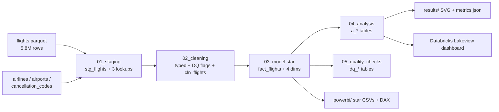

# da-learn-06 · US airline delays and cancellations (2015)

A data-analyst learning project. It analyses **every domestic flight reported by the 14 large US carriers in 2015 (5,819,079 flights)** from the US DOT on-time performance data, the well-known Kaggle "2015 Flight Delays and Cancellations" dataset. Raw Parquet goes through SQL staging, cleaning, a star schema, analysis and quality checks. DuckDB runs it locally on the **full** year and Databricks SQL runs the same pipeline. The outputs are a published Lakeview dashboard, a Power BI kit and SVG charts.

## Business questions
1. How punctual is US air travel overall, and how often are flights cancelled or diverted?
2. Which months and days are worst, and which single days collapsed?
3. Which carriers are the most and least reliable?
4. What causes the delay minutes, and what causes cancellations?
5. How do delays build up over the day, and which hub airports and routes struggle most?
6. Does flight length change how late you arrive?
7. How clean is the raw feed (duplicates, missing codes, outliers, the October airport-id quirk)?

## Pipeline


## Headline insights (full data, 5,819,079 flights)
- **Overall:** 15,943 flights a day. **81.39%** of completed flights arrived on time (under 15 min late), 1.54% were cancelled and 0.26% diverted. The average arrival delay is only 4.4 min, but a flight that is late is late by **58.9 min** on average.
- **Seasons and storms:** February has the most cancellations (**4.78%**, ten times September's 0.45%) and June the worst on-time rate (76.52%). September and October are the most punctual months (87.0% and 87.56%). The worst day was Tue 2015-01-27, the January blizzard, when 19.03% of flights were cancelled.
- **Carriers:** Hawaiian (88.67%), Alaska (86.96%) and Delta (86.44%) are the most punctual. Spirit (70.29%) and Frontier (73.84%) are the least. American Eagle cancels the most (5.10% of flights). Southwest flies the most (21.68% of all flights) at 80.95% on time.
- **Causes:** late-arriving aircraft (**39.84%**) and carrier issues (32.20%) make up 72% of late-arrival minutes. The National Air System adds 22.88% and weather only 4.95%. Yet weather causes **54.35%** of cancellations.
- **Time of day and hubs:** departure delays build through the day, from 1.9 min at 05:00 (92.7% on time) to 15.2 min at 20:00 (73.7%). Among the 10 busiest origins, Chicago O'Hare is worst (14.1 min average departure delay, 2.99% cancelled) and Minneapolis best (7.2 min). Long flights claw back time: 1,500-2,499 mi flights arrive 8.6 min less late than they depart, against 2.9 min for flights under 500 mi.
- **Data quality:** no rows were removed. There are no duplicate flight keys once the destination is included (one AA flight number left St Thomas at 14:35 on 08-29 for two destinations, so it is two legs). All 486,165 October rows use numeric BTS airport ids instead of IATA codes. They are kept for carrier, date and cause analysis and mapped to an `UNK` airport. 1,418 delays over 10 hours are kept and flagged, and all 14 assertions pass.

## How to run
```bash
pip install -r requirements.txt
python run_pipeline.py --source sample       # data/raw/ sample (24 flights + full lookups), results in results/sample/
python scripts/download_full_data.py         # ~144 MB into data/raw_full/ (SHA-256 checked, two mirrors)
python run_pipeline.py --source full         # full year: results/, data/clean_full/, powerbi/data/, ~90 s
python scripts/build_databricks.py           # regenerates the databricks/ notebook + dashboard
```
`scripts/make_sample.py` rebuilds the committed sample from the full file.

## Databricks
The notebook `databricks/airline_delays_pipeline_notebook.sql` ran on the Serverless Starter Warehouse in `workspace.da_learn_06`. The dashboard **"da-learn-06 Airline delays"** has 8 widgets and is published (`databricks/run_outputs/databricks_run.json`). All 14 pipeline-table row counts match DuckDB, and the KPI, analysis and DQ tables match cell for cell (`databricks/run_outputs/duckdb_vs_databricks.json`). See `databricks/SETUP.md`.

## Repo layout
```
data/raw/            24-flight sample + the 3 full lookup tables (full year via scripts/download_full_data.py)
sql/                 00 DuckDB shims, 01 staging, 02 cleaning, 03 star model, 04 analysis, 05 quality checks
run_pipeline.py      DuckDB runner (sample | full)
scripts/             project config, sample builder, downloader, SVG charts, Databricks generator
results/             RESULTS.md, metrics.json, JSON.shot, charts/*.svg (dashboard.svg = overview)
databricks/          exported notebook, .lvdash.json, run outputs, SETUP.md
powerbi/             star CSVs (sample-sized), measures.dax, model.md, dashboard_spec.md, BUILD_GUIDE.md
```

## Caveats
- On-time uses the BTS rule (arrival delay under 15 min) over completed flights. Cancelled and diverted flights are reported separately.
- Delay-cause minutes are reported only for flights 15+ min late, so cause shares describe late flights, not all flights.
- October 2015 airports are numeric BTS ids in this dataset, so airport and route views cover 11 months. Carrier, month and cause views cover all 12.
- Scheduled hours are local time at the origin airport, as published by BTS.
- This is 2015. US Airways merged into American and Virgin America into Alaska afterwards, so carrier rankings are historical.

## Complete dataset
- **Source:** US Department of Transportation, Bureau of Transportation Statistics, Airline On-Time Performance (Reporting Carrier On-Time Performance), calendar year 2015: https://www.transtats.bts.gov/
- **Kaggle page:** https://www.kaggle.com/datasets/usdot/flight-delays ("2015 Flight Delays and Cancellations": flights.csv, airlines.csv, airports.csv)
- **Mirror used (exact URLs, the same Kaggle files as Parquet plus a cancellation-code lookup):**
  - https://huggingface.co/datasets/hsanchezp/us-dot-flight-delays-2015/resolve/main/flights.parquet
  - https://huggingface.co/datasets/hsanchezp/us-dot-flight-delays-2015/resolve/main/airlines.parquet
  - https://huggingface.co/datasets/hsanchezp/us-dot-flight-delays-2015/resolve/main/airports.parquet
  - https://huggingface.co/datasets/hsanchezp/us-dot-flight-delays-2015/resolve/main/cancellation_codes.parquet
  - Fallback with identical files: https://huggingface.co/datasets/librown/us-dot-flight-delays-2015
- **Licence:** CC0 1.0 Public Domain (Kaggle listing). BTS data is a US federal government work.
- **Total size:** 144,157,499 bytes (~144.2 MB as Parquet)
- **Files:** `flights.parquet` (144,139,267 B, 5,819,079 rows × 31 columns; SHA-256 `4aaf9b41…925907a14`), `airlines.parquet` (645 B, 14 rows), `airports.parquet` (17,125 B, 322 rows) and `cancellation_codes.parquet` (462 B, 4 rows)
- **Download:** `python scripts/download_full_data.py` (writes to data/raw_full/ and verifies SHA-256)
