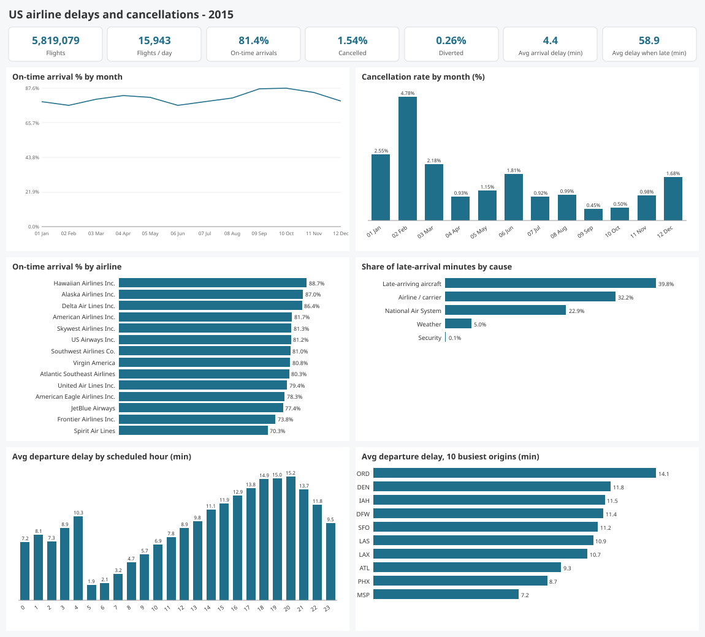
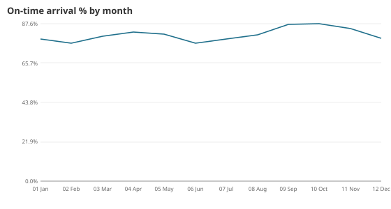
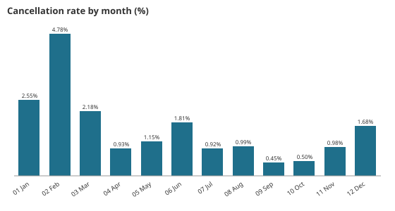
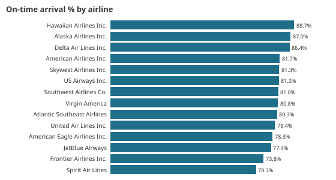
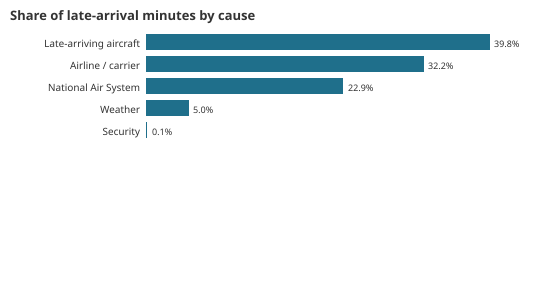
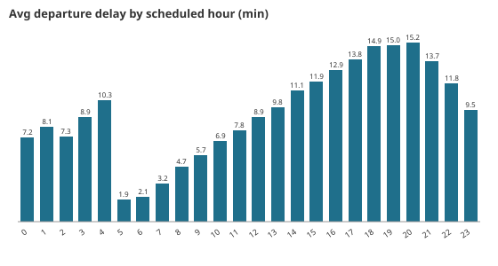
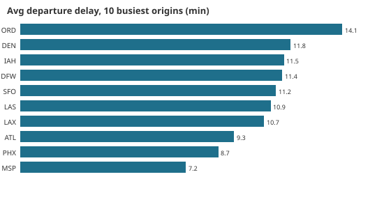

# Results: US airline delays and cancellations, 2015 (full data)

Generated by `python run_pipeline.py --source full` from 5,819,079 raw flight rows. Every number comes from `metrics.json` and the `a_*`/`dq_*` tables, and is reproduced on Databricks (`databricks/run_outputs/duckdb_vs_databricks.json`). On-time means arriving less than 15 minutes late (the BTS definition), measured over completed flights.

## KPIs
| Metric | Value |
|---|---|
| Flights (no rows removed) | 5,819,079 |
| Flights per day | 15,943 |
| Completed / cancelled / diverted | 5,714,008 / 1.54% / 0.26% |
| On-time arrival rate | 81.39% |
| Average arrival delay (completed) | 4.41 min |
| Average departure delay (not cancelled) | 9.34 min |
| Average delay when late (15+ min) | 58.91 min |
| Late-arrival minutes attributed to causes | 62,651,867 |
| Average taxi-out | 16.07 min |
| Carriers / origin airports | 14 / 322 |

## Seasonality
 

| Month | Flights | On-time | Cancelled | Avg arrival delay |
|---|---|---|---|---|
| Jan | 469,968 | 79.00% | 2.55% | 5.81 |
| Feb | 429,191 | 76.65% | **4.78%** | 8.32 |
| Mar | 504,312 | 80.60% | 2.18% | 4.92 |
| Apr | 485,151 | 82.84% | 0.93% | 3.16 |
| May | 496,993 | 81.69% | 1.15% | 4.49 |
| Jun | 503,897 | **76.52%** | 1.81% | 9.60 |
| Jul | 520,718 | 79.08% | 0.92% | 6.43 |
| Aug | 510,536 | 81.33% | 0.99% | 4.61 |
| Sep | 464,946 | 87.00% | 0.45% | -0.77 |
| Oct | 486,165 | **87.56%** | 0.50% | -0.78 |
| Nov | 467,972 | 84.74% | 0.98% | 1.10 |
| Dec | 479,230 | 79.40% | 1.68% | 6.09 |

Winter storms drive cancellations (February's rate is 4.78%, ten times September's 0.45%), while summer thunderstorms and peak loads drive delays (June has the worst on-time rate, 76.52%). The worst single days were Tue 2015-01-27 (19.03% cancelled, the January blizzard), Mon 02-02 (17.52%) and Thu 03-05 (17.19%). Saturday is the most punctual day (84.01% on time) and also the lightest (13,472 flights per day against 16,645 on Mondays).

## Carriers

| Carrier | Flights | Share | On-time | Cancelled | Avg delay when late |
|---|---|---|---|---|---|
| Southwest | 1,261,855 | 21.68% | 80.95% | 1.27% | 52.28 |
| Delta | 875,881 | 15.05% | 86.44% | 0.44% | 61.26 |
| American | 725,984 | 12.48% | 81.73% | 1.50% | 60.11 |
| SkyWest | 588,353 | 10.11% | 81.31% | 1.69% | 60.36 |
| Atlantic Southeast | 571,977 | 9.83% | 80.32% | 2.66% | 62.74 |
| United | 515,723 | 8.86% | 79.38% | 1.27% | 64.70 |
| American Eagle | 294,632 | 5.06% | 78.28% | **5.10%** | 62.96 |
| JetBlue | 267,048 | 4.59% | 77.42% | 1.60% | 61.01 |
| US Airways | 198,715 | 3.41% | 81.18% | 2.05% | 50.29 |
| Alaska | 172,521 | 2.96% | 86.96% | 0.39% | 48.09 |
| Spirit | 117,379 | 2.02% | **70.29%** | 1.71% | 63.21 |
| Frontier | 90,836 | 1.56% | 73.84% | 0.65% | 67.20 |
| Hawaiian | 76,272 | 1.31% | **88.67%** | 0.22% | 39.59 |
| Virgin America | 61,903 | 1.06% | 80.77% | 0.86% | 56.30 |

## Why flights are late, and why they are cancelled

| Delay cause | Minutes | Share |
|---|---|---|
| Late-arriving aircraft | 24,961,931 | 39.84% |
| Airline / carrier | 20,172,956 | 32.20% |
| National Air System | 14,335,762 | 22.88% |
| Weather | 3,100,233 | 4.95% |
| Security | 80,985 | 0.13% |

| Cancellation reason | Flights | Share |
|---|---|---|
| Weather | 48,851 | 54.35% |
| Airline / carrier | 25,262 | 28.11% |
| National Air System | 15,749 | 17.52% |
| Security | 22 | 0.02% |

Weather is behind more than half of all cancellations but only about 5% of delay minutes. Delays are mostly knock-on effects: a late inbound aircraft plus carrier-side causes account for 72% of the minutes.

## Time of day

Departure delays build through the day, from 1.88 min for 05:00 departures (92.73% on time) to 15.25 min at 20:00 (73.68% on time). The first wave of the morning is the safest time to fly.

## Airports, routes and distance

| Origin | Departures | On-time | Avg dep delay | Cancelled | Avg taxi-out |
|---|---|---|---|---|---|
| ATL Atlanta | 346,836 | 83.56% | 9.33 | 0.74% | 17.41 |
| ORD Chicago O'Hare | 285,884 | 75.90% | 14.07 | 2.99% | 19.55 |
| DFW Dallas/Fort Worth | 239,551 | 78.30% | 11.44 | 2.61% | 17.24 |
| DEN Denver | 196,055 | 77.60% | 11.81 | 1.08% | 15.97 |
| LAX Los Angeles | 194,673 | 79.02% | 10.65 | 1.11% | 16.95 |

Airport figures exclude October (its rows carry numeric BTS airport ids in the source). The busiest route is SFO-LAX (13,744 flights, 72.87% on time). Long flights recover time in the air: departures on 1,500-2,499 mi flights arrive 8.6 min less late than they left, against 2.9 min on flights under 500 mi.

## Data quality
| Check | Rows |
|---|---|
| Duplicate flight key incl. destination (removed) | 0 |
| Same flight number, origin and time but two destinations (multi-leg, kept) | 1 |
| Numeric BTS airport id instead of IATA, Oct 2015 (kept as UNK) | 486,165 |
| Delay over 10 hours (kept, flagged) | 1,418 |
| Tail number missing (kept) | 14,721 |
| Airports without coordinates (kept) | 3 |
| Cause minutes not summing to arrival delay | 0 |
| Cancelled without reason | 0 |

All 14 assertions in `dq_assertions` pass (key uniqueness, every foreign key resolves, status flags exclusive, on-time + late = completed, rollups equal fact rows).
